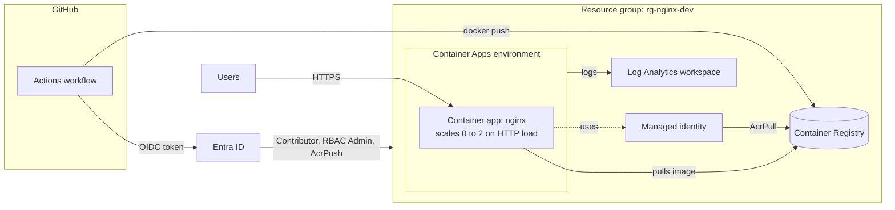

# Autoscaling nginx on Azure Container Apps (Bicep + GitHub Actions)

Deploys an autoscaling nginx container to **Azure Container Apps** using **Bicep**. The image is built from this repo, stored in a private **Azure Container Registry**, and pulled by the app through a **managed identity** (no registry passwords). **GitHub Actions** authenticates to Azure with **OpenID Connect (OIDC)**, so no long-lived credentials are stored in GitHub.

## Contents

- [Architecture](#architecture)
- [Repository structure](#repository-structure)
- [Resource summary](#resource-summary)
- [Prerequisites](#prerequisites)
- [Setup](#setup)
  - [1. Register resource providers](#1-register-resource-providers)
  - [2. Create the resource group](#2-create-the-resource-group)
  - [3. Create the service principal (SPN) with OIDC](#3-create-the-service-principal-spn-with-oidc)
  - [4. Configure GitHub](#4-configure-github)
- [Deployment](#deployment)
- [Parameters](#parameters)
- [Outputs](#outputs)
- [Verify](#verify)
- [Destroy](#destroy)
- [Troubleshooting](#troubleshooting)

## Architecture



**How a deployment flows**

1. A push to a branch matching `nginx*` starts the workflow when files under `infrastructure/` or `app/` change. The workflow can also be started manually.
2. The workflow signs in to Azure via OIDC (no secrets or passwords).
3. **Stage 1** deploys the registry, managed identity, role assignment, Log Analytics workspace and Container Apps environment (`deployApp=false`).
4. **Stage 2** builds the Docker image on the runner and pushes it to the registry, tagged with the commit SHA.
5. **Stage 3** deploys the container app (`deployApp=true`) pointing at the new image. The app pulls it using its managed identity and creates a new revision.

## Repository structure

```
.
├── .github/
│   └── workflows/
│       └── deploy.yml        # CI/CD: infra, image build/push, app deploy
├── app/
│   ├── Dockerfile            # nginx image
│   └── index.html            # sample content
├── infrastructure/
│   ├── main.bicep            # all Azure resources
│   └── dev.bicepparam        # dev environment parameter values
└── README.md
```

The workflow paths match this repository layout. Linux runners are case-sensitive.

## Resource summary

| Resource | Type | Purpose |
|---|---|---|
| Log Analytics workspace | `Microsoft.OperationalInsights/workspaces` | Collects console and system logs from the environment |
| Container Apps environment | `Microsoft.App/managedEnvironments` | Shared hosting layer for the app (networking and logging) |
| Container Registry (Basic) | `Microsoft.ContainerRegistry/registries` | Private image storage. Admin user disabled, anonymous pull off |
| User-assigned managed identity | `Microsoft.ManagedIdentity/userAssignedIdentities` | Identity the app uses to pull images |
| Role assignment (AcrPull) | `Microsoft.Authorization/roleAssignments` | Lets the managed identity pull from the registry |
| Container app | `Microsoft.App/containerApps` | nginx, external HTTPS ingress on port 80, HTTP autoscaling |

Created outside the template (one-time setup): the Entra ID app registration, its federated credential, and the role assignments for GitHub.

## Prerequisites

- An Azure subscription where you can create resources and role assignments (Owner, or Contributor plus User Access Administrator, on the subscription or resource group).
- Permission to create app registrations in Microsoft Entra ID.
- A GitHub repository with GitHub Actions enabled.
- [Azure CLI](https://learn.microsoft.com/cli/azure/install-azure-cli) 2.50 or later (includes Bicep support). Check with `az version`.
- Optional for local testing: [Docker](https://docs.docker.com/get-docker/) and Git.
- A shell. Commands below are **bash** (Linux, macOS, WSL, Azure Cloud Shell). PowerShell notes are included where syntax differs.

Sign in and select your subscription:

```bash
az login
az account set --subscription "<subscription name or id>"
az account show --query "{name:name, subscription:id, tenant:tenantId}" -o table
```

## Setup

### 1. Register resource providers

Run once per subscription. New subscriptions often have these unregistered, which causes provisioning failures.

```bash
for ns in Microsoft.App Microsoft.OperationalInsights Microsoft.ContainerRegistry Microsoft.ManagedIdentity; do
  az provider register --namespace $ns --wait
done

az provider list \
  --query "[?namespace=='Microsoft.App' || namespace=='Microsoft.OperationalInsights' || namespace=='Microsoft.ContainerRegistry' || namespace=='Microsoft.ManagedIdentity'].{namespace:namespace, state:registrationState}" \
  -o table
```

All four should show `Registered`. `Microsoft.Authorization` is registered by default.

### 2. Create the resource group

```bash
az group create --name rg-nginx-dev --location australiaeast
```

### 3. Create the service principal (SPN) with OIDC

This creates the identity GitHub Actions signs in as. Replace `<owner>/<repo>` with your GitHub path (for example `jane/bicep-nginx-autoscale`). It is case-sensitive.

```bash
# App registration and service principal
APP_ID=$(az ad app create --display-name github-nginx-deploy --query appId -o tsv)
az ad sp create --id $APP_ID
echo "AZURE_CLIENT_ID = $APP_ID"

# Federated credential: trust tokens from the GitHub "dev" environment
az ad app federated-credential create --id $APP_ID --parameters '{
  "name": "github-dev",
  "issuer": "https://token.actions.githubusercontent.com",
  "subject": "repo:<owner>/<repo>:environment:dev",
  "audiences": ["api://AzureADTokenExchange"]
}'

# Role assignments scoped to the dev resource group
SUB_ID=$(az account show --query id -o tsv)
SCOPE="/subscriptions/$SUB_ID/resourceGroups/rg-nginx-dev"

az role assignment create --assignee $APP_ID --role "Contributor" --scope $SCOPE
az role assignment create --assignee $APP_ID --role "Role Based Access Control Administrator" --scope $SCOPE
az role assignment create --assignee $APP_ID --role "AcrPush" --scope $SCOPE

# Values needed for GitHub secrets
az account show --query "{tenant:tenantId, subscription:id}" -o table
```

| Role | Why it is needed |
|---|---|
| Contributor | Create and update the Azure resources |
| Role Based Access Control Administrator | Lets the template create the AcrPull role assignment (Contributor cannot). Use `User Access Administrator` if your tenant does not offer this role |
| AcrPush | Push images to the registry from the workflow |

**PowerShell notes:** set variables with `$APP_ID = az ad app create ... -o tsv`, use a backtick `` ` `` for line continuation, and pass the federated credential through a file because inline JSON gets mangled:

```powershell
@'
{
  "name": "github-dev",
  "issuer": "https://token.actions.githubusercontent.com",
  "subject": "repo:<owner>/<repo>:environment:dev",
  "audiences": ["api://AzureADTokenExchange"]
}
'@ | Set-Content -Path cred.json
az ad app federated-credential create --id $APP_ID --parameters cred.json
Remove-Item cred.json
```

**Update an existing credential** (for example after renaming the repo):

```bash
az ad app federated-credential update --id $APP_ID --federated-credential-id github-dev --parameters '{
  "name": "github-dev",
  "issuer": "https://token.actions.githubusercontent.com",
  "subject": "repo:<owner>/<repo>:environment:dev",
  "audiences": ["api://AzureADTokenExchange"]
}'
```

Shell variables do not persist between sessions. If `$APP_ID` is empty, reload it:

```bash
APP_ID=$(az ad app list --display-name github-nginx-deploy --query "[0].appId" -o tsv)
```

### 4. Configure GitHub

**Create the environment:** repo **Settings > Environments > New environment**, named `dev`. The workflow job uses `environment: dev`, and the federated credential subject ends in `environment:dev`, so the names must match.

**Add the secrets:** repo **Settings > Secrets and variables > Actions > New repository secret** (or add them under the `dev` environment to keep them per-environment).

| Secret | Value | Where to find it |
|---|---|---|
| `AZURE_CLIENT_ID` | Application (client) ID of the app registration | `$APP_ID` from step 3, or Entra ID > App registrations > Overview |
| `AZURE_TENANT_ID` | Directory (tenant) ID | `az account show --query tenantId -o tsv` |
| `AZURE_SUBSCRIPTION_ID` | Subscription ID | `az account show --query id -o tsv` |

No client secret or password is needed. Azure only accepts the sign-in if the GitHub token matches the federated credential (repo and environment).

## Deployment

**Automatic:** push to a branch matching `nginx*` with changes under `infrastructure/` or `app/`.

**Manual:** repo **Actions > deploy > Run workflow**.

**Local test before pushing:**

```bash
az bicep build --file infrastructure/main.bicep

az deployment group what-if \
  --resource-group rg-nginx-dev \
  --template-file infrastructure/main.bicep \
  --parameters infrastructure/dev.bicepparam
```

Note: the real pipeline passes `DEPLOY_APP` and `IMAGE` as environment variables (read by `dev.bicepparam`). Locally, `DEPLOY_APP` defaults to `true` and the image to public `nginx:stable`.

## Parameters

Defined in `infrastructure/main.bicep`. Dev values are set in `infrastructure/dev.bicepparam`.

| Parameter | Type | Default | Dev value | Description |
|---|---|---|---|---|
| `appName` | string | none (required) | `nginx-dev` | Base name for all resources |
| `location` | string | resource group location | resource group location | Azure region |
| `image` | string | `docker.io/nginx:stable` | set by workflow (`IMAGE`) | Full image reference. The workflow passes the registry image tagged with the commit SHA |
| `deployApp` | bool | `true` | set by workflow (`DEPLOY_APP`) | `false` creates only the registry, identity, workspace and environment. Used in stage 1 |
| `acrName` | string | `acr` + unique string | default | Registry name. 5 to 50 lowercase letters and numbers, globally unique |
| `minReplicas` | int (0 to 30) | `1` | `0` | Minimum replicas. `0` scales to zero when idle |
| `maxReplicas` | int (1 to 30) | `10` | `2` | Maximum replicas |
| `concurrentRequests` | string | `'50'` | `'20'` | Concurrent HTTP requests per replica before scaling out |
| `cpu` | string | `'0.25'` | default | vCPU per replica |
| `memory` | string | `'0.5Gi'` | default | Memory per replica |
| `logRetentionDays` | int (30 to 730) | `30` | default | Log Analytics retention |

For production, add an `infrastructure/prod.bicepparam` (for example `minReplicas = 2` for an always-on app) and a `prod` GitHub environment with required reviewers and its own federated credential (`...:environment:prod`).

## Outputs

| Output | Description |
|---|---|
| `acrName` | Name of the container registry |
| `acrLoginServer` | Registry login server, for example `acrxxxxxxxx.azurecr.io` |
| `url` | Public HTTPS URL of the app (empty when `deployApp` is `false`) |

Get them after a deployment:

```bash
az deployment group show -g rg-nginx-dev -n main --query properties.outputs -o json
```

The deployment name is `main` by default (the template file name). Or query the app directly:

```bash
az containerapp show -n nginx-dev -g rg-nginx-dev --query properties.configuration.ingress.fqdn -o tsv
```

## Verify

```bash
# Image is in the registry
ACR=$(az acr list -g rg-nginx-dev --query "[0].name" -o tsv)
az acr repository show-tags -n $ACR --repository nginx-app -o table

# App is running the private image
az containerapp show -n nginx-dev -g rg-nginx-dev \
  --query "properties.template.containers[0].image" -o tsv

# Replicas
az containerapp replica list -n nginx-dev -g rg-nginx-dev -o table

# Test and generate load to watch autoscaling
URL=https://$(az containerapp show -n nginx-dev -g rg-nginx-dev --query properties.configuration.ingress.fqdn -o tsv)
curl -I $URL
# hey -z 60s -c 100 $URL
```

With `minReplicas = 0`, the first request after idle time has a cold start of a few seconds.

## Destroy

Bicep has no destroy command. Delete the resource group (this removes everything inside it, permanently):

```bash
az group delete --name rg-nginx-dev --yes --no-wait
```

This also removes the role assignments scoped to that group. To tear down but keep the SPN permissions, delete only the environment and registry instead. Clean up the identity when you are fully done:

```bash
az ad app delete --id $APP_ID
```

Then remove the three GitHub secrets.

## Troubleshooting

| Error | Cause and fix |
|---|---|
| `AADSTS70025` or `No matching federated identity record` | Credential subject does not match. Check `repo:<owner>/<repo>:environment:dev` spelling and case, and that the job uses `environment: dev` |
| `AuthorizationFailed` creating a role assignment | The SPN is missing Role Based Access Control Administrator on the resource group |
| `ManagedEnvironmentProvisioningError` | Inspect the failed deployment operations and Activity Log for the underlying error. Confirm `Microsoft.App` is registered in the workflow's subscription (`az provider show --namespace Microsoft.App --query registrationState -o tsv`). Don't delete a failed environment until you have checked the error and confirmed the resource is safe to remove. |
| `TasksOperationsNotAllowed` | ACR Tasks is blocked on some subscription types. This repo avoids it by using `docker build` and `docker push` on the runner instead of `az acr build` |
| Push says `unauthorized` or `denied` | AcrPush role is missing or has not propagated yet. Wait a couple of minutes and rerun |
| `Unable to find 'app/Dockerfile'` | Folder must be at the repo root, correctly cased, and committed. Check with `git ls-files app` |
| `argument --id: expected one argument` | `$APP_ID` is empty in your shell. Reload it (see step 3) |
| Image pull fails on the app | Check the managed identity has AcrPull (`az role assignment list --scope <acr id> -o table`) and rerun after role propagation |
